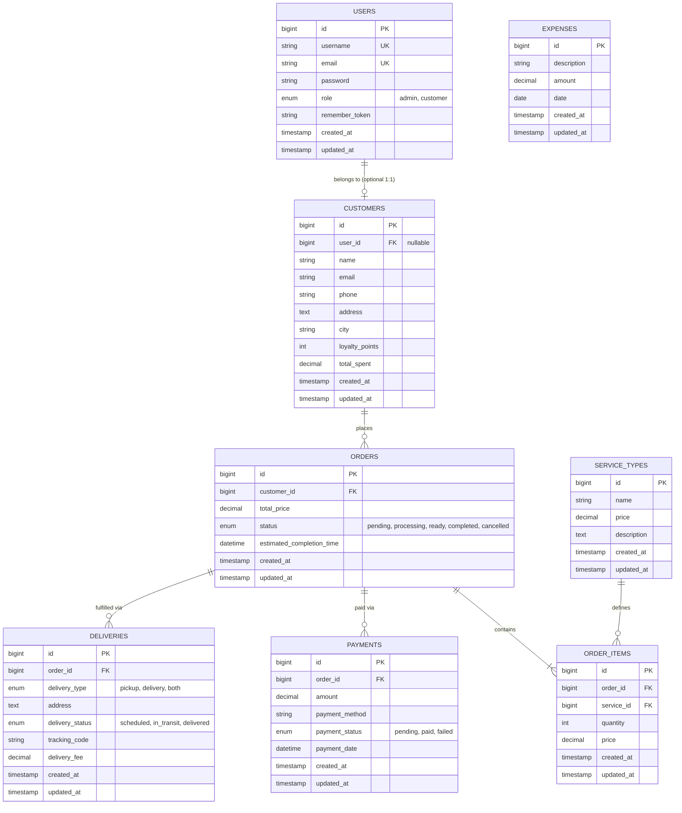

# Database Schema Reference — Rodeo Laundry

## 1. Entity Relationship Diagram (ERD)

---

## 2. Table Specifications

### 2.1 `users`
- **Migration:** `0001_01_01_000000_create_users_table.php`
- **Model:** `App\Models\User.php`
- **Columns:**
  - `id` (bigint, PK, auto-increment)
  - `username` (varchar 50, unique)
  - `email` (varchar 100, unique)
  - `password` (varchar 255)
  - `role` (enum: `'admin'`, `'customer'`, default: `'customer'`)
  - `remember_token` (varchar 100, nullable)
  - `created_at`, `updated_at`

### 2.2 `customers`
- **Migration:** `2026_10_04_001642_create_customers_table.php`
- **Model:** `App\Models\Customer.php`
- **Columns:**
  - `id` (bigint, PK, auto-increment)
  - `user_id` (foreign key to `users.id`, nullable, on delete cascade)
  - `name` (varchar 100)
  - `email` (varchar 100, nullable)
  - `phone` (varchar 20, nullable)
  - `address` (text, nullable)
  - `city` (varchar 50, nullable)
  - `loyalty_points` (int, default: 0)
  - `total_spent` (decimal 10,2, default: 0)
  - `created_at`, `updated_at`

### 2.3 `service_types`
- **Migration:** `2026_10_04_001707_create_service_types_table.php`
- **Model:** `App\Models\ServiceType.php`
- **Columns:**
  - `id` (bigint, PK, auto-increment)
  - `name` (varchar 100)
  - `price` (decimal 10,2)
  - `description` (text, nullable)
  - `created_at`, `updated_at`

### 2.4 `orders`
- **Migration:** `2026_10_04_001714_create_orders_table.php`
- **Model:** `App\Models\Order.php`
- **Columns:**
  - `id` (bigint, PK, auto-increment)
  - `customer_id` (foreign key to `customers.id`, on delete cascade)
  - `total_price` (decimal 10,2, default: 0)
  - `status` (enum: `'pending'`, `'processing'`, `'ready'`, `'completed'`, `'cancelled'`, default: `'pending'`)
  - `estimated_completion_time` (datetime, nullable)
  - `created_at`, `updated_at`

### 2.5 `order_items`
- **Migration:** `2026_10_04_001848_create_order_items_table.php`
- **Model:** `App\Models\OrderItem.php`
- **Columns:**
  - `id` (bigint, PK, auto-increment)
  - `order_id` (foreign key to `orders.id`, on delete cascade)
  - `service_id` (foreign key to `service_types.id`, on delete cascade)
  - `quantity` (int)
  - `price` (decimal 10,2)
  - `created_at`, `updated_at`

### 2.6 `payments`
- **Migration:** `2026_10_04_001854_create_payments_table.php`
- **Model:** `App\Models\Payment.php`
- **Columns:**
  - `id` (bigint, PK, auto-increment)
  - `order_id` (foreign key to `orders.id`, on delete cascade)
  - `amount` (decimal 10,2)
  - `payment_method` (varchar 50)
  - `payment_status` (enum: `'pending'`, `'paid'`, `'failed'`, default: `'pending'`)
  - `payment_date` (datetime, nullable)
  - `created_at`, `updated_at`

### 2.7 `deliveries`
- **Migration:** `2026_10_04_001908_create_deliveries_table.php`
- **Model:** `App\Models\Delivery.php`
- **Columns:**
  - `id` (bigint, PK, auto-increment)
  - `order_id` (foreign key to `orders.id`, on delete cascade)
  - `delivery_type` (enum: `'pickup'`, `'delivery'`, `'both'`, default: `'pickup'`)
  - `address` (text, nullable)
  - `delivery_status` (enum: `'scheduled'`, `'in_transit'`, `'delivered'`, default: `'scheduled'`)
  - `tracking_code` (varchar 50, nullable)
  - `delivery_fee` (decimal 10,2, default: 0)
  - `created_at`, `updated_at`

### 2.8 `expenses`
- **Migration:** `2026_10_04_125727_create_expenses_table.php`
- **Model:** `App\Models\Expense.php`
- **Columns:**
  - `id` (bigint, PK, auto-increment)
  - `description` (varchar 255)
  - `amount` (decimal 10,2)
  - `date` (date)
  - `created_at`, `updated_at`

---

## 3. Seeded Test Credentials
- **Admin:** `admin@rodeo.com` / `password` (username: `admin`)
- **Customer 1:** `customer1` / `password`
- **Customer 2-5:** `customer2` - `customer5` / `password`
