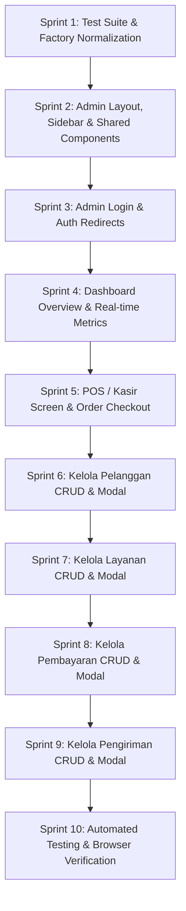

# Product Requirements Document (PRD) & Master Planning
## Project: Rodeo Laundry Malang — Admin Management & POS Dashboard

- **Project Name:** Rodeo Laundry Malang (Admin Portal)
- **Repository:** `kallw4n/rodeo-laundry`
- **Scope Division:**
  - **Customer Portal:** Handled by teammate (`frontPage`, `pemesanan`, `pengiriman`, `pembayaran`, `pesanan`).
  - **Admin Portal & POS:** Handled in this phase, 100% based on Figma screenshots in `docs/figma/`.
- **Tech Stack:** Laravel 12, Blade Templates, Tailwind CSS (v3 / Vite), Alpine.js, Laragon MySQL 8.4, PHP 8.3

---

## 1. Design & Feature Breakdown (From Figma Specifications)

### 1.1 Shared Admin Layout (`resources/views/layouts/admin.blade.php`)
- **Brand Identity & Sidebar Navigation:**
  - Logo: Rodeo laundry circular icon with electric lime accent + `Rodeo.Laundry`.
  - Navigation links:
    1. **Dashboard** (`/admin/dashboard` or `/admin`) — Icon: grid dashboard.
    2. **POS / Kasir** (`/admin/pos` or `/admin/kasir`) — Icon: cash register.
    3. **Pelanggan** (`/admin/pelanggan` or `/customers`) — Icon: users group.
    4. **Layanan** (`/admin/layanan` or `/service-types`) — Icon: sparkles / price tag.
    5. **Pembayaran** (`/admin/pembayaran` or `/payments`) — Icon: payment cards.
    6. **Pengiriman** (`/admin/pengiriman` or `/deliveries`) — Icon: delivery truck.
  - Active state: Deep navy background (`#1F1D47`), crisp white text, electric lime right indicator dot (`#BFF108`).
  - Bottom profile pill: User avatar `R`, name `Admin Rodeo`, fast logout button.
- **Top Bar:**
  - Search input: `Cari nota, nomor rak, pelanggan...`.
  - Date widget: `Hari Ini: [Tanggal Live]` with calendar icon.
  - Notification bell with unread dot.
  - Profile quick menu button.

---

### 1.2 Screen 1: Dashboard Overview (`docs/figma/page dahsboard.png`)
- **Header:** `Selamat Pagi, Admin` + `Ringkasan operasional dan performa hari ini.` + Action `Unduh Laporan`.
- **4 Real-time Metric Cards:**
  1. `TOTAL PESANAN` — Dynamic count from `orders`, badge `+14.2%`.
  2. `PENDAPATAN HARI INI` — Hero card in dark navy (`#1E1B4B`), formatted currency `Rp X.XX jt`, lime green highlight.
  3. `PELANGGAN AKTIF` — Dynamic count from `customers`, badge `+X Baru`.
  4. `ANTRIAN MESIN AKTIF` — Count of orders with status `processing`/`pending`, badge `● X Urgent`.
- **Tabel Pesanan Terbaru:**
  - Columns: ID & WAKTU (`#RD-XXXX`, jam:menit), PELANGGAN (nama & no HP), LAYANAN, TOTAL BAYAR, STATUS (badge warna dot), AKSI (menu dropdown).
  - Filter: `Semua Status` dropdown.
  - Export: `Export Rekap` button.
  - Pagination & count summary: `Menampilkan X dari Y pesanan aktif`.

---

### 1.3 Screen 2: Point of Sale (POS) / Kasir (`docs/figma/page kasir.png`)
- **Header:** `Point of Sale (POS) / Kasir` + `Input transaksi cepat, timbang cucian digital, dan cetak nota kasir.`
- **Pelanggan Selector:**
  - Live search pelanggan + tombol `Scan Kartu`.
  - Active customer badge card: Inisial avatar, nama, nomor telepon, alamat, badge `Gratis Antar-Jemput Aktif`, tombol clear/close `x`.
- **Katalog Layanan (Grid 2 Kolom):**
  - Kartu paket layanan: Nama layanan, harga & satuan (`/kg`, `/pcs`, `/pasang`), estimasi durasi, tag fitur, tombol `+ Tambah`.
- **Cart & Nota Ringkasan (Right Sidebar):**
  - Header: `NOTA BARU #ROD-XXXX`, `Ringkasan Pesanan`, tanggal & jam saat ini.
  - Daftar Item yang dipilih: Nama layanan, kuantitas/berat, harga subtotal, tombol hapus (icon trash).
  - Rincian Biaya: Subtotal item, Ongkir Antar-Jemput (GRATIS/nominal), Total Tagihan.
  - Metode Pembayaran (4 Tombol Interaktif):
    - `QRIS / E-Wallet`
    - `Tunai / Cash`
    - `Transfer Bank`
    - `Bayar Saat Antar`
  - Input `Uang Tunai Diterima` dengan kalkulator kembalian otomatis.
  - Action Buttons: `Simpan & Cetak Struk` (Lime button `#BFF108`) dan `Simpan Jadi Draft / SPK Cuci`.
  - Status indicator: `Printer Kasir Siap` • `WhatsApp Otomatis`.

---

### 1.4 Screen 3: Kelola Pelanggan & Modal Tambah (`docs/figma/page pelanggan.png` & `page tambah pelanggan.png`)
- **Header:** `Kelola Pelanggan` + subtitle + tombol `+ Tambah Pelanggan`.
- **Filter Bar:** Search bar (nama, email, no telepon, kota), Filter `Semua Kota (Malang Raya)`, Urutan sorting.
- **Tabel Pelanggan:** ID, Pelanggan, Email, Telepon, Kota (pill badge), Aksi (Edit, Delete).
- **Modal Tambah/Edit Pelanggan:**
  - Header: Icon user plus lime, Judul `Tambah Pelanggan Baru`, close `x`.
  - ID Pelanggan auto badge `#RD-XXXX` (Dibuat otomatis oleh sistem).
  - Form Fields: Nama Lengkap (*), Email (Opsional), No Telepon/WA (* prefix `+62`), Kota/Wilayah Layanan (* dropdown), Alamat Lengkap / Catatan Pengantaran (* textarea).
  - Info Box: `Nota digital dan pelacakan progress cuci otomatis dikirimkan ke nomor WhatsApp pelanggan setelah disimpan.`
  - Tombol: `Batal`, `Simpan Pelanggan`.

---

### 1.5 Screen 4: Kelola Layanan & Modal Tambah (`docs/figma/page layanan.png` & `page tambah layanan.png`)
- **Header:** `Kelola Layanan` + subtitle + tombol `+ Tambah Layanan`.
- **Filter Bar:** Search bar, Filter kategori, Urutan sorting.
- **Tabel Layanan:** ID, Nama Layanan / Item (dengan dot status), Harga (pill badge), Deskripsi, Aksi (Edit, Delete).
- **Modal Tambah/Edit Layanan:**
  - Header: Icon tag lime, Judul `Tambah Layanan Baru` (badge `POS READY`), close `x`.
  - ID Layanan auto badge.
  - Kategori Layanan (Pill selectors): `Kiloan`, `Satuan`, `Sepatu / Tas`, `Karpet`.
  - Nama Layanan / Item (*).
  - Harga Layanan (IDR) & Unit Satuan Tarif (`per Kg`, `per Pcs`, `per Meter`).
  - Deskripsi Layanan (maks 150 karakter).
  - Toggle Switch: `Status Layanan Aktif` (Langsung sinkron & tampil pada mesin POS Kasir).
  - Tombol: `Batal`, `Simpan Layanan`.

---

### 1.6 Screen 5: Kelola Pembayaran & Modal Catat (`docs/figma/page pembayaran.png` & `page tambah pembayaran.png`)
- **Header:** `Kelola Pembayaran` + subtitle + tombol `+ Catat Pembayaran`.
- **Tabel Pembayaran:** ID Nota, Nama Pelanggan, Jenis Layanan, Berat Cucian, Harga, Status (`Lunas` lime dot, `Belum Lunas` red dot), Aksi (Edit, Delete).
- **Modal Catat Pembayaran:**
  - Header: Icon struk/kartu, Judul `Catat Pembayaran`.
  - Nomor Nota / ID Transaksi auto.
  - Nama Pelanggan (dengan validasi/checklist icon).
  - Jenis Layanan dropdown & Berat Cucian (kg/pcs).
  - Total Harga / Tagihan.
  - Status Pembayaran: Pills `Lunas`, `Belum Lunas`, `DP (Deposit)`.
  - Metode Pembayaran Dipilih: Kartu `QRIS Statis/Dinamis`, `Tunai / Cash`, `Transfer / EDC`.
  - Nominal Uang Diterima & kalkulasi otomatis `Kembalian Kasir`.
  - Tombol: `Batal`, `Simpan Tanpa Cetak`, `Simpan & Cetak Bukti Bayar`.

---

### 1.7 Screen 6: Kelola Pengiriman & Modal Jadwalkan (`docs/figma/page pengiriman.png` & `page tambah pengiriman.png`)
- **Header:** `Kelola Pengiriman` + subtitle + tombol `+ Jadwalkan Antar Baru`.
- **Tabel Pengiriman:** ID Nota, Pelanggan & Kontak, Rincian Cucian, Alamat Pengantaran, Status Antar (`Belum di Antar` orange pill, `Sedang di Antar`, `Selesai`), Aksi:
  - Tombol Motor (`Kirim`): Ubah status langsung jadi `Sedang di Antar` / `in_transit`.
  - Tombol Check (`Selesai`): Ubah status jadi `Selesai` / `delivered`.
  - Tombol Edit & Delete.
- **Modal Jadwalkan Antar Baru:**
  - Header: Icon truk kirim, Judul `Jadwalkan Antar Baru` (badge `EKSPEDISI LOKAL`).
  - ID Nota Cucian (badge `LUNAS`).
  - Nama Pelanggan & Kontak WA.
  - Rincian Cucian & Alamat Lengkap Pengantaran.
  - Form: Pilih Driver / Kurir Armada (*), Jadwal & Slot Waktu (*), Status Antar Awal.
  - Catatan Khusus Pengantaran.
  - Checkbox `Notifikasi WhatsApp otomatis terkirim ke customer`.
  - Tombol: `Batal`, `Konfirmasi & Jadwalkan Antar`.

---

### 1.8 Screen 7: Halaman Login Admin (`docs/figma/page login.png`)
- Card layout centered:
  - Kiri: Foto cucian laundry estetik + testimonial card (Rating 4.9/5.0, 18.4k+ Pesanan badge).
  - Kanan: Logo `Rodeo.Laundry`, Judul `Masuk ke Akun`, Form Email & Password, Toggle Show Password, Remember Me, Tombol `Masuk ->`, Opsi Akun Google, Link Daftar.

---

## 2. Master Execution Plan (Sprints)

---

## 3. Verification & Testing Matrix
1. **Automated Testing:**
   - Run `php artisan test` after every sprint.
   - All tests must pass with 0 errors.
2. **Build Validation:**
   - Run `npm run build` to verify Vite asset compilation.
3. **Browser Testing:**
   - Verify every screen in Chrome subagent:
     - Navigation between sidebar items.
     - Modal opening, form submission, and validation errors.
     - POS item addition, price calculation, and order generation.
     - Status update buttons (Pengiriman, Pembayaran).
     - Responsive behavior on desktop (1440px) and laptop (1024px).
