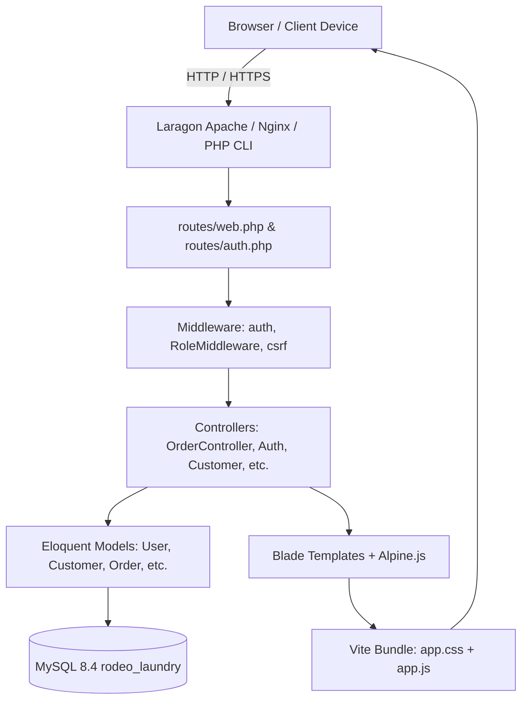
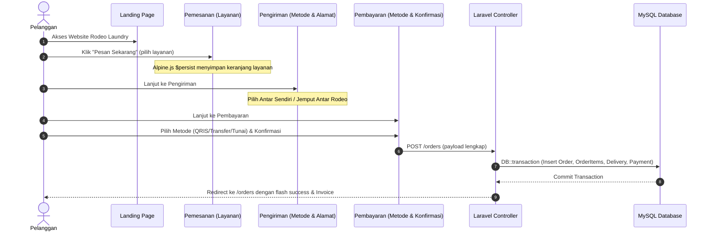

# System Architecture & Technical Specifications

## 1. High-Level Architecture Overview

Rodeo Laundry follows a clean Layered MVC Architecture in Laravel 12, serving server-rendered Blade templates integrated with Vite, Tailwind CSS, and reactive Alpine.js components.



---

## 2. Customer Booking Flow Architecture



---

## 3. Security & Access Control Matrix

| Route Group | Path | Allowed Roles | Middleware |
|---|---|---|---|
| **Public** | `/` | Guest, Customer, Admin | `web` |
| **Auth** | `/login`, `/register`, `/forgot-password` | Guest only | `guest` |
| **Customer Booking** | `/pemesanan`, `/pengiriman`, `/pembayaran` | Authenticated (`customer`, `admin`) | `auth` |
| **Customer Orders** | `/orders`, `/pesanan` | Authenticated | `auth` |
| **Admin Operations** | `/service-types`, `/customers`, `/payments`, `/deliveries`, `/expenses` | Authenticated (`admin`) | `auth`, `role:admin` |

---

## 4. State Management (Client-Side & Server-Side)

### 4.1 Client-Side (Alpine.js Persist)
- Key: `rodeo_booking_cart`
- Fields:
  ```json
  {
    "items": [
      { "id": 1, "name": "Cuci Kering Biasa", "price": 5000, "qty": 3, "unit": "pcs" },
      { "id": 2, "name": "Cuci Setrika Kiloan", "price": 8000, "qty": 5, "unit": "kg" }
    ],
    "delivery": {
      "type": "both",
      "address": "Jl. Soekarno Hatta No. 45, Malang",
      "city": "Malang",
      "pickup_time": "2026-10-18T10:00",
      "notes": "Tolong jangan dicampur baju putih dengan warna pekat"
    },
    "payment": {
      "method": "qris"
    }
  }
  ```

### 4.2 Server-Side Synchronization
- Transactional integrity using `DB::transaction()`:
  - If payment or delivery record creation fails, order and order items are cleanly rolled back.
  - Calculation validation: Prices are strictly verified against `ServiceType` prices in database to prevent client tampering.
